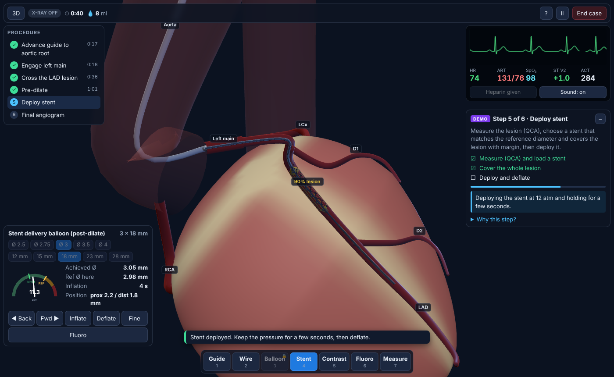
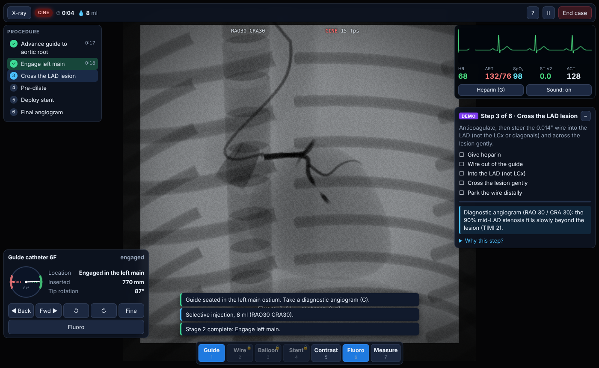
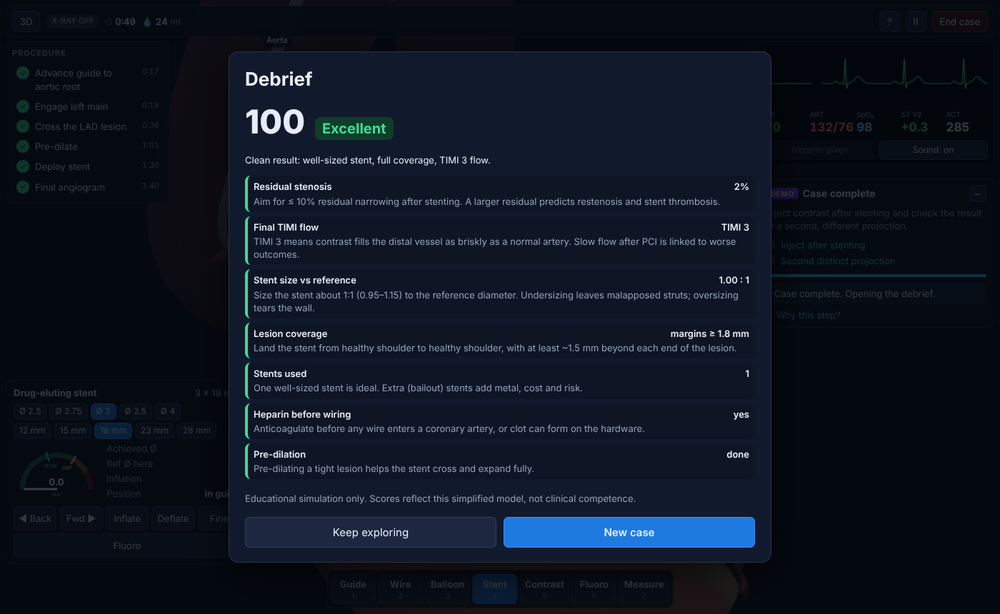

# Cath Lab Simulator



A browser-based **educational** simulator of percutaneous coronary intervention (PCI): stenting a 90% mid-LAD stenosis through right radial access. Everything runs in the browser tab: procedural anatomy, a fake X-ray view, a patient monitor and a scored debrief.

> **Educational demo only.** This is a coding project for learning and demonstration. It is not clinical training or medical advice, and its numbers are simplified teaching approximations.

## Run it

```bash
npm install && npm run dev
```

Open the local link Vite prints, then click **Watch a demo first** to see the whole case run on autopilot (it ends on an *Excellent* debrief), or **Enter the cath lab** to do it yourself.

| Command | What it does |
| --- | --- |
| `npm run dev` | Start the dev server |
| `npm run build` | Type-check (strict) and build to `dist/` |
| `npm test` | Run the unit tests (Vitest) |

**Tests: 44 unit tests, all passing.** They cover the stenosis profile, balloon/stent pressure–diameter curves, coverage margins, flow and TIMI grades, contrast transit (slows past the lesion, stops behind a balloon in D2 but not D1, recovers after stenting), dissections, the balloon catheter rules, physiology and ECG, guide engagement, wire steering and forcing, stage progression, tool unlocking, debrief scoring, a full demo run, and a deliberately bad case.

## What you can do

- Guide a 6F catheter from the wrist, up the arm and into the aortic root, then rotate its curved tip into the left coronary cusp
- Switch between a lit 3D view and a fluoroscopy view (15 fps pulsed frames, noise, collimation, last-image hold) with C-arm presets
- Inject contrast and watch it fill the arteries; the 90% lesion fills slowly (TIMI 2)
- Steer a 0.014" wire past the LCx and diagonals and across the lesion without forcing it
- Pre-dilate with a balloon and deploy a stent while a pressure gauge tracks every atm
- A patient monitor that reacts: V2 ECG with ST elevation, heart rate, blood pressure, ACT, PVCs and alarms
- A mentor panel for the six stages, and a scored debrief with a teaching point for each item

| Diagnostic angiogram | Debrief |
| --- | --- |
|  |  |

## Controls

`1–7` tools · `W/S` or wheel advance/retract (`Shift` fine) · `A/D` rotate · `E` hold inflate / `Q` deflate · `G` heparin · `5` or `C` contrast · `Space` or `6` hold fluoro · `Tab` 3D/X-ray · `V`/arrows C-arm · `F` follow · `L` labels · `H` help · `M` mentor · `N` sound · `Esc` pause · drag / `Ctrl`+wheel orbit/zoom. On touch screens, the device panel has hold buttons.

## How it is built

- **Stack:** Vite, TypeScript (strict), Three.js, Web Audio, Vitest. No backend; all state is in memory.
- **Pure simulation core.** Sizing, flow, scoring and stages are pure functions with no Three.js or DOM code (`src/anatomy`, `src/physics`, `src/procedure`, `src/tools`), so the demo and a bad case run headlessly in the tests.
- **One config file.** Every anatomy size, device size and physiology constant lives in `src/config/anatomy.ts`. 1 scene unit = 1 mm.
- **1D rail devices.** Catheters, wires and balloons slide by arc length along vessel centrelines.

```
src/config/anatomy.ts   all constants
src/state/store.ts      single state object + tiny subscribe/emit
src/anatomy/            procedural heart, vessel tree, lumen profiles
src/physics/            flow + TIMI, devices, physiology, synthetic ECG
src/tools/              tool rules and the device controller
src/procedure/          simulation step, stages, hints, debrief, demo
src/scene/              Three.js renderer, X-ray materials, geometry
src/ui/                 HUD, panels, monitor, debrief
src/audio/              monitor beep + alarm
tests/                  unit tests
```

## Done when

- `npm run build` and `npm test` pass
- The demo completes all 6 stages with no console errors and ends on an *Excellent* debrief
- A deliberately bad case (an oversized 4.0 × 12 mm stent at 18 atm) produces an edge dissection, reduced flow and a *Needs work* debrief (see `tests/debrief.test.ts`)

## What I would do differently

_Fill this in after you have used it: three sentences on what you would change next time._

## Credits

Built from the spec-style prompt in the "Build a Cath Lab in a Browser Tab" guide by @hinnazeejah, with Claude Code.
